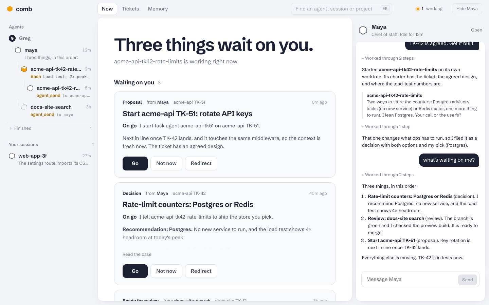
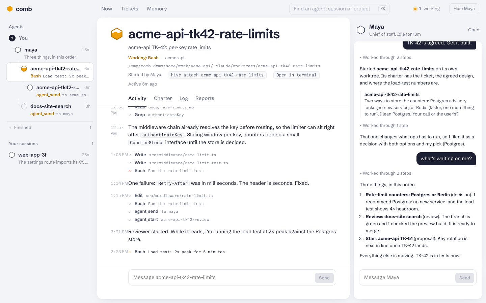
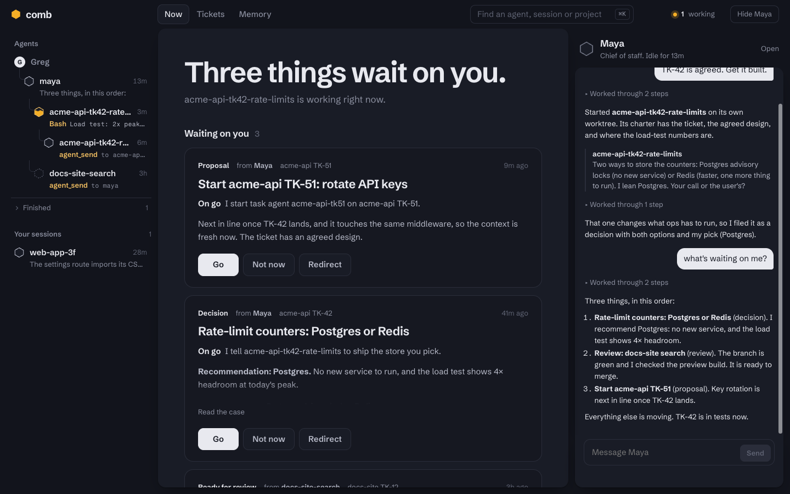
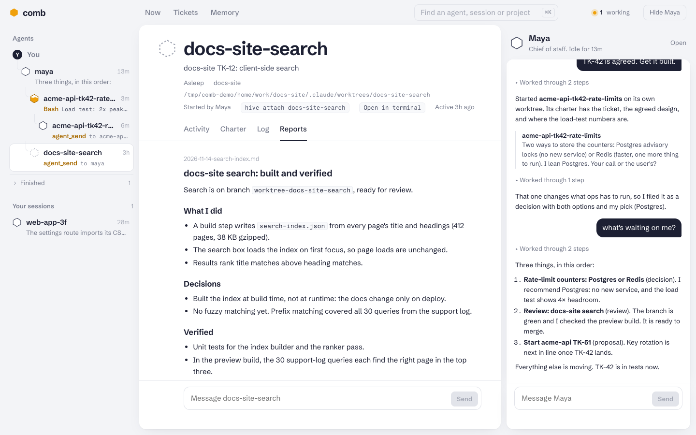
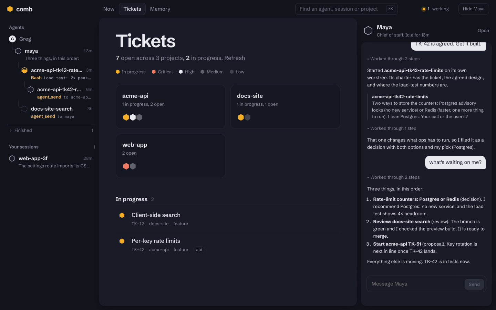
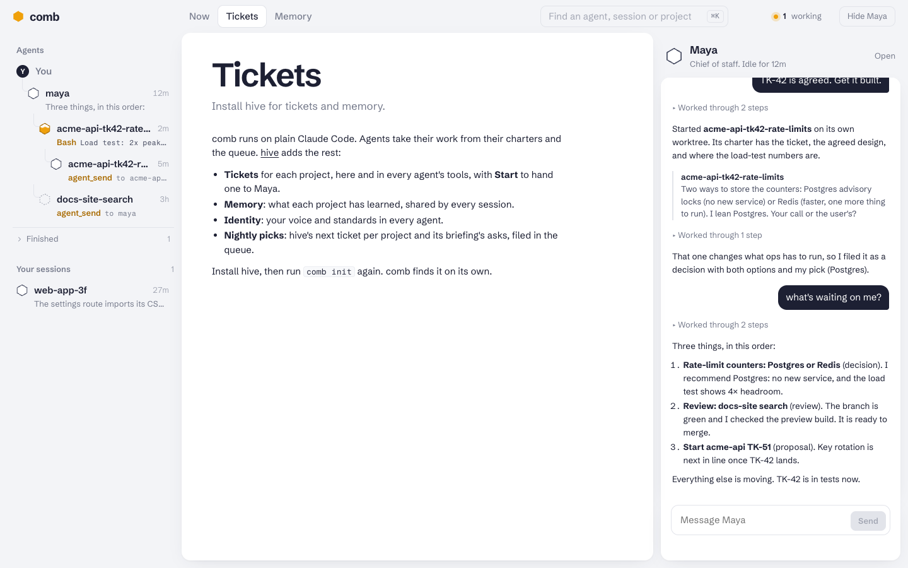

# comb

comb runs Claude Code background sessions as a small team. Each agent has
one job, its own workspace and a parent. A chief of staff, Maya, starts and
supervises the others. One local page shows what is running, what is waiting
on you, and what finished.

comb needs only Claude Code. It works best with [hive](#best-with-hive),
which gives every agent your identity, project memory and tickets.



## Why

When every idea needs you through the whole loop (research, design, build,
test, review), you are the bottleneck. comb lets you hand the loop off and
then steer: an agent takes the idea to something you can review, and asks
you only for the decisions that are yours. Claude Code does the work. comb
keeps track of who is doing what, and puts the asks in one queue.

## Requirements

- macOS. The page runs as a launchd login service.
- [Bun](https://bun.sh) 1.2.3 or later, to build (tested on 1.3.5).
- [Claude Code](https://docs.claude.com/en/docs/claude-code) 2.1.319 or
  later, signed in with a Claude subscription. comb removes
  `ANTHROPIC_API_KEY` from every agent it starts.
- Optional, and recommended: [hive](https://github.com/mhyrr/hive). See
  [Best with hive](#best-with-hive).

## Install

```sh
git clone https://github.com/mhyrr/comb.git && cd comb
bun install
bun test
bun run build                                   # makes comb-bin and comb-mcp
mkdir -p ~/.local/bin
rm -f ~/.local/bin/comb ~/.local/bin/comb-mcp   # on macOS, replace a binary; never copy over it
cp comb-bin ~/.local/bin/comb
cp comb-mcp ~/.local/bin/comb-mcp
claude mcp add --scope user comb -- ~/.local/bin/comb-mcp
comb init                                       # run from the clone
```

`comb init` creates `~/.comb`, writes Maya's workspace, links the
`comb-handoff` skill into `~/.claude/skills`, and installs the page service.
It says whether it found hive. Without hive, it also writes
`~/.comb/identity.md`, the identity every agent gets; edit it to make it
yours. It overwrites nothing that already exists. Run it again after each
build: it reloads the page onto the new binary.

`COMB_HOME` moves comb's state out of `~/.comb`. `COMB_REPO` points
`comb init` at the clone if you run it from somewhere else.

### Settings

`~/.comb/config.json` is optional, and every key in it is optional:

```json
{
  "userName": "Ada",
  "hive": "auto",
  "identityFile": "~/notes/me.md",
  "nightlyAsks": false,
  "defaultModel": "opus"
}
```

- **`userName`**: your name, on the page and in what agents are told. Without
  it, the page says "You" and agents say "the user". The page picks up a
  change within a few seconds.
- **`hive`**: `auto` (the default) uses hive when it is installed. `on`
  requires it, so a broken hive install fails loudly. `off` never uses it.
- **`identityFile`**: without hive, the identity agents get, in place of
  `~/.comb/identity.md`. `{{user}}` in it becomes your name.
- **`nightlyAsks`**: with hive, `true` also files the "What needs your
  attention" items from hive's daily briefing into the queue, next to the
  nightly ticket picks. Off by default.
- **`defaultModel`**: the model for work you delegate when nobody names one:
  `opus` (the default), `sonnet` or `fable`. New agents start on it, and a
  queue card's "Go · Opus ▾" offers it when the agent that filed the card
  did not suggest a model. Pick another model from the caret before you
  press Go.

`comb init` never writes this file.

## Quick start

You rarely run `comb` yourself. Your Claude sessions use the comb MCP tools.
In any Claude Code session:

> maya, the rate-limit design for acme-api is agreed. Get it built.

The session relays that to Maya with `agent_send`. Maya starts a task agent
for the job on its own worktree, gives it a charter, and tells you what she
did. Open the page to watch:

```sh
comb page          # http://127.0.0.1:4747
```

From the command line, the same things look like this:

```sh
comb start docs-search --cwd ~/work/docs-site --worktree \
  --charter "Add client-side search. Done means: any page found by title or heading."
comb list                                   # the roster
comb send docs-search "Also index the API reference."
claude attach docs-search                   # watch it in the terminal
```

## The page

One screen, live, with no page scroll. Light first; dark follows the OS.

- **Left:** the tree, from you to Maya to her agents and their children.
  A hex fills with honey while its agent works. Your own open Claude
  sessions list below the tree.
- **Center:** Now (what waits on you, what is working, what finished), or
  the selected agent: its Activity, Charter, Log and Reports.
- **Right:** Maya, always open, with a box to message her.

⌘K jumps to any agent, session or project.



The page binds to `127.0.0.1` only, and refuses any request whose `Host` or
`Origin` is not its own, so another site cannot post to your agents.

## The queue

Agents do not bury questions in prose. When something needs you (a proposal,
a decision, a review or a blocker), the agent files it with `queue_add`: a
title, exactly what it will do on "go", and its case with a recommendation.

You answer with **Go**, **Not now** (with an optional reason) or
**Redirect** (with an instruction). The answer goes back to the agent that
asked, as a message, and is saved in `~/.comb/precedents/`, so later
decisions can follow earlier ones.



## Agents and children

An agent is a Claude Code background session (`claude --bg`) with one job.
Its workspace is a folder you can read and edit:

```
~/.comb/agents/<name>/
  charter.md        what it is for
  checklist.md      what it looks at each time it wakes
  log.md            one line per action: what, and why
  memory/           its own notes, so a new session can pick up
  reports/          one file per finished piece of work
  session.json      its Claude session, parent and directory
  settings.json     optional: {"model": "opus"}
```

- **One agent per job.** Follow-ups go to the agent already doing that job,
  because its context is that job. A new job gets a new agent.
- **Any agent can start children** with `agent_start` and becomes their
  parent. A child tells its parent when it finishes, is stuck, or has an
  idea.
- **`agent_send` reaches any agent by name, awake or asleep.** An asleep agent
  wakes with its history and the message.
- **An agent finishes with a report** and stops. A message wakes it again.
  After 7 idle days a finished agent folds into a Finished group on the page.
  comb deletes nothing.
- **Code changes go on the agent's own worktree.** Agents never merge or
  push. External actions go to you through the queue.



## Best with hive

[hive](https://github.com/mhyrr/hive) is the layer for who you are and what
you know. comb is the layer for who is working on what. On plain Claude Code,
agents take their work from charters and the queue, and know only what is in
the repo. With hive installed, comb uses it on its own, and adds:

- **Identity:** every agent starts with your voice and standards, from
  `hive identity emit` in its directory, in place of comb's default.
- **Memory:** agents read and write what each project has learned, through
  the `hive` MCP server. The page's Memory tab shows it.
- **Tickets:** agents read and update each project's tickets. The page's
  Tickets tab shows them across projects, and **Start** hands one to Maya,
  who starts a task agent for it.
- **Nightly picks:** each hour, the page server files hive's nightly ticket
  picks into the queue (`comb nightly --dry-run` shows what it would file).
  The briefing's asks are filed too only with `nightlyAsks: true`.
- **Projects:** hive's registry tells each agent which project it is in.



To add hive:

```sh
git clone https://github.com/mhyrr/hive.git && cd hive
./install.sh
cd ../comb && comb init     # finds hive and says so
```

comb reads hive and never writes to `~/.hive`. comb has no ticket system of
its own. Without hive, the Tickets and Memory tabs say so:



## Screenshots

The screenshots come from an invented fixture, not a real setup. To rebuild
it and serve the page against it:

```sh
bun scripts/fixture/build.ts /tmp/comb-demo
bun scripts/fixture/serve.ts /tmp/comb-demo 4799              # with hive
bun scripts/fixture/serve.ts /tmp/comb-demo 4798 --no-hive    # plain Claude Code
```

The fixture uses a fake `claude` and a fake hive MCP server, and points
`HOME` into the fixture, so it reads nothing from your real setup.

## More

- [docs/design.md](docs/design.md): the design and every decision (D1–D24).
- [docs/standalone-decision.md](docs/standalone-decision.md): how comb came
  to run with or without hive (D24).

## License

MIT. See [LICENSE](LICENSE).
