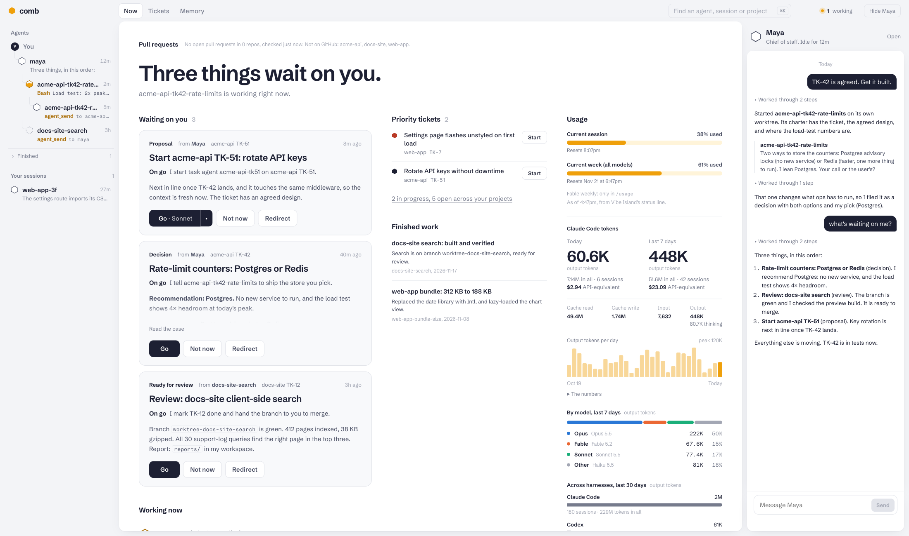
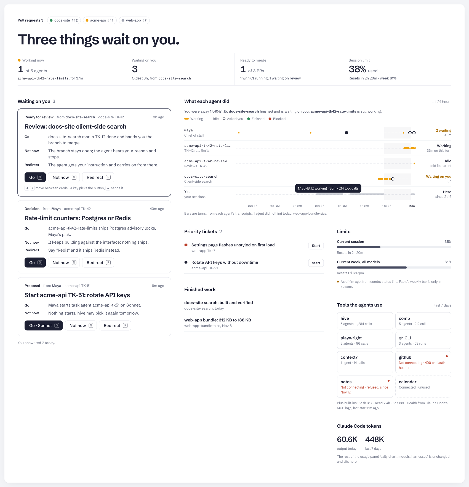
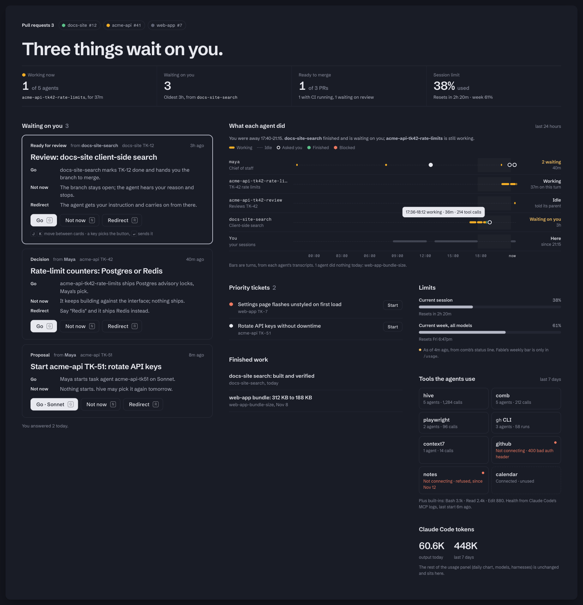
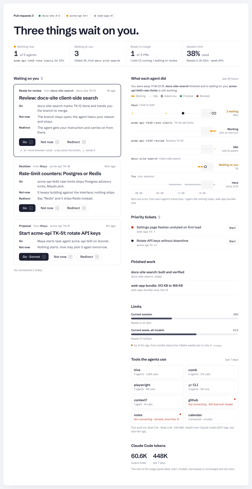
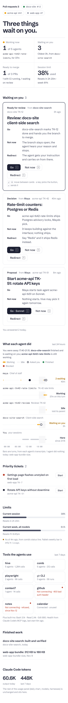
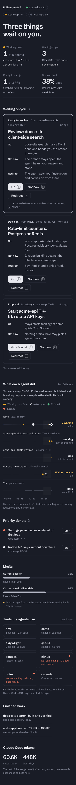

# Now, second cut: what happened, what needs me, how much room is left

**Status:** proposal, for Greg's review. Nothing here is built.
**Date:** 2026-11-17.
**Mock:** `docs/design/mocks/now-dashboard.html` (static HTML in comb's own
tokens; open it at any width, `?theme=dark` for dark). Every name and number
in the mock and the screenshots belongs to the invented fixture world
(`scripts/fixture/build.ts`). The mock adds three PRs and a 24-hour history
that the fixture does not have yet.

**How Greg will know it worked:** he opens Now after an evening away and,
without scrolling, can say which agents worked while he was gone, what waits
on him and for how long, and how much of his session is left.

## 1. The problem

Greg opens Now with three questions, and he wants each answered in about two
seconds:

1. **What happened while I was away?**
2. **What needs me?**
3. **How much room is left?** (plan limits, and whether the tools are up)

Today's Now (built 2026-11-11, extended 2026-11-17 with PRs, usage and limits):

| Question | Answered today? | Where, and what is missing |
|---|---|---|
| What needs me | **Yes.** | The headline ("Three things wait on you.") and the queue. Each card says what Go does. It does not say what Not now or Redirect do, and there are no keys. |
| What happened while I was away | **No.** | "Working now" shows only the present. "Finished work" lists reports, not when they landed. Nothing shows who worked overnight, who waited on Greg and how long, or who did nothing. To find out, Greg opens agents one by one. |
| How much room is left | **Partly.** | The limit bars are in the usage column, below the fold on a laptop. Tool health is not shown at all: on 2026-11-17 three MCP servers were failing (one 400, one refused, one 502), and only a session's start-up banner said so. |

The usage column also answers a fourth question nobody asks in two seconds
(how many tokens this month). It stays, but lower.

**Critique of today's page** (impeccable critique, run degraded: a single
context instead of two isolated sub-agents, to keep the doc's cost down).

- Strengths. One honey accent that only means "working". The headline is a
  sentence, not a number. The queue cards carry the agent's case.
- The subline under the headline ("acme-api-tk42-rate-limits is working right
  now.") is the only summary of the rest of the system, and it is prose that
  grows with each working agent.
- Three sections answer "what is going on" in three different shapes:
  Working now (live tool lines), Latest from your sessions (last words), and
  the rail (state cells). None of them has time on an axis.
- The detector finds one issue that matters for this proposal: the
  `--graphite` text token is 4.2:1 on white, under WCAG AA's 4.5:1. Every
  secondary line on the page uses it (see decision 11).

## 2. What we took from the reference, and what we didn't

The reference is a third-party dashboard Greg liked ("Night shift", not in
the repo). Its ideas are good; its look is not comb's.

**Taken:**

- **A figure strip under the title.** Four numbers, each with one line of
  context. The context line is what makes a number readable in two seconds.
- **One lane per agent over the night**, with a bar while working, a gap
  while idle, markers where it asked a person, and its state in words on the
  right ("Waiting on you · 3h").
- **"Tools the agents use"** as a small grid, with a dot and a short reason
  on the broken ones ("Expired", "Hit credit limit"). Greg: "I do like the
  whole things, like tools the agent uses is super cool."
- **Consequences on the card**: "If you approve: … If you send it back: …",
  and key hints on the buttons.

**Not taken:**

- **Its look.** No colored icon per agent, no hatched "Down" fills, no
  categorical colors for agents. comb's lanes are all the same honey,
  because honey means "working" and nothing else.
- **Spend as a headline figure.** Greg is on a subscription; dollars are
  API-equivalent and live in the usage panel. The strip shows the session
  limit instead, which is what actually stops work.
- **Runs and success percentages.** comb agents do jobs, not runs. "99.8%
  finished on their own" has no honest source in comb.
- **The side panel with the open item.** The queue stays the main column
  and opens its own cases inline (D26 keeps it stable while Greg works it).
- **"How sure the agent is."** No agent reports a calibrated confidence, and
  a made-up percentage would teach Greg to trust a number that means nothing.
- **"When a person disagreed"** is kept for later (§4.5), because it needs a
  month of answers before it says anything.

## 3. The proposed layout

From the top: the PR strip (unchanged), the headline sentence, the figure
strip, then the grid.

**Wide, stage at least 1440px (three columns).** The queue keeps column one
from top to bottom. The timeline spans columns two and three, because 24
hours needs width: at a third of the stage it got about 10px an hour, and
the bars turned into dots. Under it, tickets and finished work sit in column
two; limits, tools and tokens in column three.

**Medium, stage 980–1439px (two columns).** The queue on the left. On the
right: timeline, tickets, finished work, limits, tools, tokens. The timeline
moves the agent's name above its lane when it has under 640px, so the 24
hours keep the full width.

**Phone, and any stage under 980px (one column).** Headline, the strip as
two by two, the queue, then the timeline, tickets, limits, tools, finished
work and tokens. No horizontal scroll at 390px (checked: `scrollWidth` 390).

| Light | Dark |
|---|---|
|  |  |

Today's phone view, for comparison: [img/now-today-phone-light.png](img/now-today-phone-light.png).

**What leaves.** The headline's subline (the strip replaces it) and the
"Working now" section (the strip names the working agent; the timeline and
the rail show it live). See decision 5.

## 4. The components

Each component says what it reads or runs. Rule for all of them: a source
that can't be read says so on the page, in the component, in one line.

### 4.1 Headline strip

Four figures, each a link to the block that explains it.

| Figure | Number | Context line | Reads |
|---|---|---|---|
| Working now | agents on a turn, "of N agents" | the working agent's name and how long its turn has run; with more than one, "acme-api-tk42 and 2 more" | the snapshot (`state.ts`) the page already has |
| Waiting on you | open queue items | age of the oldest, and who filed it | the snapshot's queue |
| Ready to merge | PRs whose readiness is `ready`, "of N PRs" | how many are running CI, failing, or waiting on review | `/api/pulls` (`github.ts`), already fetched |
| Session limit | five-hour `used_percentage` | time to reset, and the week's figure | `/api/usage` → `limits.ts`, already fetched |

- **The headline sentence stays, the subline goes.** The sentence answers
  question 2 in words, and the strip is the subline done as figures. Decision 1.
- Honey appears once: the hex beside "Working now", filled only when
  something is working.
- No new source and no new request. It is client code over data the page
  already has.
- Without hive, there are no PRs (`fillPulls` already needs hive), so the
  strip shows three figures.
- With the limits file missing or stale, the figure says "No reading" or
  "As of 2h ago" in its context line, and keeps the number grey.

### 4.2 The 24-hour timeline: "What each agent did"

One lane per agent that did anything in the last 24 hours. Lanes keep tree
order (Maya first, then working agents, then by last activity), so they line
up with the rail.

| Mark | Meaning | Source |
|---|---|---|
| Honey bar | a turn: from the message that started it to its end | `turn_duration` lines in the agent's Claude Code transcripts |
| Dashed hairline | idle | the gaps |
| Ring | filed a queue item (asked Greg) | `created` in `~/.comb/queue/*/item.md`, matched on `from` |
| Filled ring | Greg answered it | the item's `answered` |
| Green hex | wrote a report | file times in `reports/` |
| Red hex | filed a blocker | a queue item of kind `blocker` |
| Right side | its state now, in words: Working (turn length), Waiting on you · age, Blocked · age, Idle, Asleep | the snapshot plus the queue |

A line under the title says the headline of the night in one sentence,
built from the same data: "You were away 17:40–21:15. docs-site-search
finished and is waiting on you; acme-api-tk42-rate-limits is still
working." Hovering a bar shows its times, length and tool-call count; a
click opens the agent. Agents with no activity in the window are named in
one footnote line, not drawn.

**Where working spans come from.** `log.md` is too sparse: an agent writes
a line every 20 to 60 minutes, and its own times are approximate. The
transcripts are exact. Claude Code writes a `system` line with subtype
`turn_duration` at the end of every turn (`transcript.ts` already parses it),
so a turn is `[end − duration, end]`. The usage index (`usage.ts`) already
reads every transcript incrementally and caches per file. It gains one
small record per turn: session, end and duration. Agents map to sessions
through `session.json` and the `(session xxxxxxxx)` ids that every
"started by" and "resumed by" line in `log.md` carries, because a woken
agent gets a new session each time.

Cost: the cache version goes up, so the first read after the upgrade
re-reads everything once (about 8 seconds on Greg's 4.3 GB, measured for
the usage panel), then incremental as now.

**Greg's own sessions** get one quiet grey lane at the bottom, "You", and
the last gap of an hour or more in it is shaded across all lanes as "You
were away". That shading is what turns the chart into an answer to "what
happened while I was away". Decision 3, with an open question: past
sessions must be told apart as interactive or background from the
transcript alone, and that is not verified yet.

Accessibility (dataviz rules): one series per lane, so no categorical
palette. State is never color alone: the right side says it in words, and
markers differ in shape (bar, ring, hex). Each lane gets an `aria-label`
summary ("docs-site-search: worked 16:47 to 18:48, finished, waiting on you
for 3 hours"), which doubles as the table view.

### 4.3 Tools the agents use, with MCP health

A two-column grid of tiles: each MCP server the agents called in the last
7 days, with "N agents · M calls", plus the `gh` CLI. One footnote line
names the top built-ins (Bash, Read, Edit) with counts.

**Counts.** Tool calls are `tool_use` blocks in the transcripts. The usage
index reads the same lines already. It gains one record per call: the
block's id (to dedupe resumed copies, which repeat earlier lines), time,
session and the tool's name. `mcp__<server>__<tool>` gives the server.
Nothing else from the call is kept. For `gh`, the index reads the first
word of a Bash command and keeps it only if it is on a short list (`gh` for
now); decision 6.

**Health.** Claude Code writes one log file per MCP server per session
start, at `~/Library/Caches/claude-cli-nodejs/<project>/mcp-logs-<server>/<ISO time>.jsonl`.
Each holds `"Successfully connected …"` or `"Connection failed (502): …"`.
On 2026-11-17 these logs held the three failures Greg saw (400, refused,
502), fresh to the minute. Reading the newest file per server is read-only,
spawns nothing, and touches no credentials. The tile shows a red dot, "Not
connecting", and the code or a short reason; a server that has failed since
a given day says so.

The alternative, `claude mcp list` cached hourly, runs a health check that
starts every stdio server and connects to every remote one: heavier, and it
does things. Decision 7. The risk of the logs: their path and format are
not documented, and on Linux they live under `~/.cache`. The reader lives
in one module, says "Health unknown: Claude Code's MCP logs not found" when
they are missing, and still shows the counts.

Servers that connect but no agent used in 7 days get a dashed tile,
"Connected · unused", capped at two, so the grid shows what is wired up
without listing every plugin.

### 4.4 Queue cards: what each button does, and keys

Each card lists what each answer does, in one line each:

- **Go:** the item's `action`, as today.
- **Not now:** new optional `queue_add` field `onNo`. Without it, comb
  writes "Nothing happens. The agent hears your reason."
- **Redirect:** always "The agent gets your instruction and works from it,"
  unless the agent names a likely redirect (`onRedirect`, optional).

Opinions about the work live in files: the core contract will ask agents to
fill `onNo` when "not now" changes something (a branch stays open, a pick
returns tomorrow). Decision 8.

**Keys.** `J` and `K` move between cards; the current card gets an outline.
`G`, `N` and `R` move focus to that button on the current card; `Enter`
sends it. One key never sends, so a stray keystroke cannot answer an item.
`N` and `R` open the note form as today. Keys work only when no text field
has focus. The hints sit in the buttons as small `kbd` marks. Decision 9.
D26 holds: a key never moves a card Greg is looking at.

### 4.5 Later: how often Greg disagrees, per agent

Per agent, the share of its queue items answered Not now or Redirect, over
30 days, as a small strip of marks (solid = changed). Source:
`~/.comb/precedents/` (one file per answer, with the verdict). It tells
Greg which agents to trust with less review, and tells Maya whose charters
need work. It needs a month of answers to mean anything, so it waits until
the precedent count supports it. No build in this round.

### 4.6 Limits

The two bars (session and week) stay at the top of column three, and the
session figure moves into the strip. The source is the open question:

- Today `limits.ts` reads Vibe Island's `~/.vibe-island/cache/rl.json`.
  Greg said no to any Vibe Island dependency (2026-11-17).
- A queue item from Maya is open: "Let comb wrap your status line so the
  limit bars don't need Vibe Island". On Go, `comb statusline` copies
  `rate_limits` to `~/.comb/cache/` and then runs Greg's existing status
  line unchanged. It changes `statusLine.command` in
  `~/.claude/settings.json`, which needs an exception to the "never change
  global Claude config" rule. The design is in comb-usage-panel's workspace.
- The mock's source line reads "from comb's status line", which assumes Go.

Whatever Greg decides there, this proposal only moves the session figure
into the strip, and `limits.ts` stays the one module that knows the
source. Decision 10.

### 4.7 Sessions comb can't see today

Greg (2026-11-17): "I've got live hive sessions in my terminal ... I don't
see them in the your sessions area." These are plain interactive `claude`
processes in terminal tabs, started by hive's launcher with
`--append-system-prompt`, some running for 14 to 18 days.

**What is actually happening (checked 2026-11-17, read-only, no root).**
comb does see them. The cause is folding.

- `claude agents --json` lists all 12 of Greg's interactive sessions,
  terminal tabs included, each with its name, kind `interactive`,
  status `idle` or `busy`, sessionId and cwd. Claude Code also writes
  `~/.claude/sessions/<pid>.json` for each one, with the same fields and a
  messaging socket. So option (b) below already exists, built by Claude
  Code itself.
- The live page's snapshot holds all 12 under `mine`. 7 of them have
  `finished: true`: they sit in the collapsed **Finished** group under Your
  sessions. A session folds when its last real event (a message, words, a
  tool call) is more than `foldAfterHours` (24) old (D22). One of them last
  worked about 30 hours before the check. Its transcript file had been
  touched 24 minutes earlier, but only by bookkeeping lines, which
  `state.ts` ignores on purpose.
- `lsof -d cwd` on those PIDs works as Greg's user and returns each
  one's project directory. It is not needed, because the
  session file already has the cwd.

So the bug is a rule, not a blind spot: **an open terminal tab is not
finished work.** D22 was written for agents that wrote their report and for
sessions Greg had walked away from. A tab he keeps open for two weeks is a
standing workspace that he returns to.

**The options Maya listed, re-weighed against this:**

- (a) comb discovers terminal sessions itself, from recent transcripts and
  live `claude` PIDs with a tty. Not needed: Claude Code already reports
  them, and a second discovery path would disagree with the first.
- (b) hive's launcher registers each session somewhere comb reads. Already
  done by Claude Code (`~/.claude/sessions/<pid>.json`, and
  `claude agents --json`).
- (c) Greg starts sessions with `claude --bg`. Not needed, and it would
  change how he works.
- (d) New: **a live interactive session never folds.** It stays in Your
  sessions, sorted by last activity, with its idle time ("quiet 1d")
  instead of a Finished label. Only a session whose process has ended folds,
  and only after the same 24 hours.

**Recommend (d).** It is a few lines in `sessionFolds` (`state.ts`) plus a
test, and it can ship before everything else in this doc. With 12 open
tabs the list gets long, so Your sessions shows the 6 most recent and a
"6 more, quiet" row that opens the rest. Decision 13.

**What a terminal session can and can't do on the page:**

| Can | Can't |
|---|---|
| Show its status (working, idle) and its latest words and tool calls, read from its transcript | Be started, stopped or resumed by comb. Its process belongs to the terminal tab |
| Receive a message while its process runs: it has a messaging socket, so the page's `SendMessage` relay reaches it, and the message arrives as a cross-session message on its next turn | Be woken once its tab is closed. There is no session left to deliver to, and comb does not resume Greg's sessions |
| Show which project it is in (cwd) | Open in a new terminal tab: it already has one, and the page offers no button for Greg's sessions today (§9.1) |

## 5. Decisions for Greg

1. **Headline.** (a) Keep the sentence; the strip replaces the subline.
   (b) Replace the sentence with the strip. **Recommend (a):** the sentence
   is the fastest answer to "what needs me", and it is what makes Now feel
   like comb.
2. **Where the timeline sits on wide screens.** (a) Across columns two and
   three, next to the queue (mock). (b) A full-width band between the strip
   and the queue. **Recommend (a):** the queue stays at the top of the main
   column, and the timeline gets 60% of the width, enough for 24 hours.
3. **Your own sessions on the timeline.** (a) One grey "You" lane, with the
   last hour-plus gap shaded as "away". (b) Leave them out. **Recommend
   (a),** if transcripts can tell interactive sessions from background ones
   (to verify in PR 3; if they can't, ship (b) and say so).
4. **Source for working spans.** (a) Turn starts and ends from the
   transcripts, through the usage index. (b) `log.md` lines only.
   **Recommend (a):** exact, and it costs one cache re-read. (b) would draw
   bars nobody could trust.
5. **"Working now" and "Latest from your sessions".** (a) Drop Working now,
   keep Latest. (b) Keep both. (c) Drop both. **Recommend (a):** the strip,
   the timeline and the rail cover Working now; the last words in Latest are
   not anywhere else.
6. **What counts as a tool.** (a) MCP servers plus the `gh` CLI (first word
   of a Bash command, matched to a fixed list, nothing else kept). (b) MCP
   servers only. **Recommend (a).** And: count calls from comb agents only,
   not Greg's own sessions, so the panel means what its title says.
7. **Source for MCP health.** (a) Claude Code's MCP logs, read-only.
   (b) `claude mcp list`, cached hourly. **Recommend (a):** it spawns
   nothing. Caveat: undocumented path and format; the page says when it
   can't read them.
8. **What "Not now" does, on the card.** (a) Optional `onNo` and
   `onRedirect` fields on `queue_add`, with comb's default text. (b) comb's
   default text only. **Recommend (a).**
9. **Keys.** (a) `J`/`K` to move, `G`/`N`/`R` to focus a button, `Enter` to
   send. (b) One key sends. **Recommend (a):** one keystroke more, and a
   stray key can't answer an item.
10. **Limits source.** This is the open queue item about the status-line
    wrapper. **Recommend Go** on it, as Maya filed it. If not, the strip's
    fourth figure and the bars come off rather than read Vibe Island.
11. **The `--graphite` token.** It is 4.2:1 on white; AA needs 4.5:1.
    **Recommend** darkening it one step (about `#6B7080`) in light mode
    only. Every secondary line on the page gets more legible, and the look
    does not change.
12. **Disagreement rate.** **Recommend later,** as in §4.5.
13. **Your terminal sessions** (§4.7). (a) A live interactive session never
    folds; the list shows 6 and a "N more, quiet" row. (b) Keep D22's
    24-hour fold for them too. (c) Never fold them, and show all.
    **Recommend (a),** shipped first, on its own.

## 6. Build order

Layered PRs, each green and useful on its own. Each one regenerates its
screenshots from the fixture, which gains a 24-hour history, PRs, tool
calls and MCP logs as each PR needs them.

0. **Open terminal sessions stop folding** (§4.7, decision 13). Small, and
   independent of the rest. Tests: a live interactive session idle for days
   does not fold; an ended one does after 24 hours.
1. **Figure strip** (client only). Strip, subline removed, Working now
   removed (if decisions 1 and 5 go that way). Tests: the four figures from
   a snapshot, the PR report and the limits, including missing sources.
2. **Usage index, version 2.** Turn records and tool-call records in
   `usage.ts`, cache version bump, `gh` first-word match. Tests: from
   fixture transcripts, turns and calls are counted once across resumed
   copies; no tool input is stored.
3. **Timeline.** Server: `/api/timeline` joins turns, sessions from
   `log.md` and `session.json`, the queue and `reports/` into lanes. Page:
   the lanes, markers, state words, the summary line, hover and click.
   Tests: lane derivation from fixture logs; a hand cross-check of one
   lane against that agent's `log.md`.
4. **Tools panel and MCP health.** Server: counts from PR 2, plus a
   one-module reader of Claude Code's MCP logs. Page: the grid. Tests: log
   parsing for connected, 400, refused and 502, and the missing-logs line.
5. **Queue cards.** `onNo` and `onRedirect` in `queue_add` and the core
   contract; consequence lines; keys. Tests: defaults, the keys never send
   on one keystroke, focus stays put (D26).
6. **Later:** disagreement rate, from `precedents/`.

The status-line wrapper (decision 10) belongs to comb-usage-panel and ships
on its own.

## 7. What the page reads or runs, after all of this

- Reads, already: `~/.comb/agents/*` (session.json, log.md, reports/),
  `~/.comb/queue/`, `claude agents --json`, transcripts under
  `~/.claude/projects/`, `gh pr list`, the limits file.
- Reads, new: turn-end and tool-use lines in the same transcripts (through
  the existing usage index), and Claude Code's MCP logs under
  `~/Library/Caches/claude-cli-nodejs/`.
- Runs, new: nothing.
